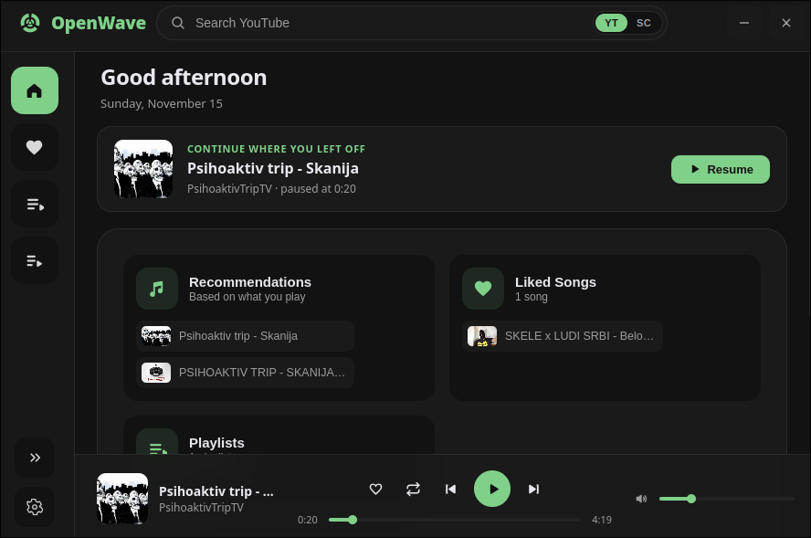
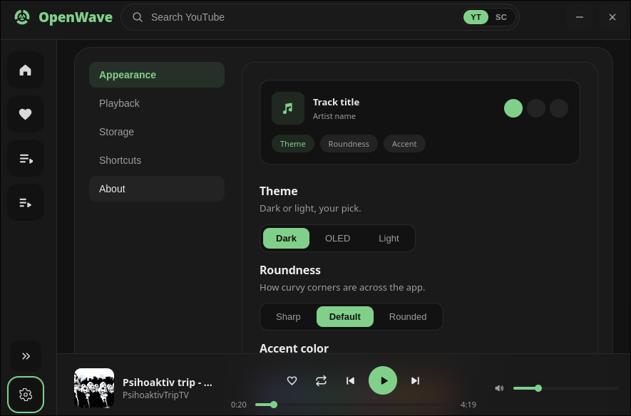

<div align="center">


# OpenWave 🌊

**Free, open-source music player for desktop. Streams from YouTube and SoundCloud.**

No accounts · No ads · No subscriptions · No telemetry

[](https://github.com/molxxt/openwave/releases)
[](LICENSE)
[](#download)

</div>

---

## ✨ Screenshots

| Home | Settings |
|:---:|:---:|
|  |  |

Frosted glass interface with a live audio visualizer, themes (dark / OLED / light),
custom accent colors, and a floating player bar — all of it yours to tweak.

## 🎧 What it does

OpenWave is a desktop music player built with **Electron** and powered by
**[yt-dlp](https://github.com/yt-dlp/yt-dlp)**. Search for anything on YouTube or
SoundCloud and stream the audio instantly — no accounts, no ads, no tracking.
Your playlists, likes and history stay on your computer.

- 🔍 **Search YouTube & SoundCloud** — one click to switch sources
- 🖥️ **Expanded player** — big artwork, live spectrum visualizer, your queue beside it
- 📋 **Playlists & queue** — drag & drop from search, drag to reorder, persistent everywhere
- ❤️ **Liked songs & recommendations** — based on what you actually play
- ⏯️ **Resume playback** — picks up where you left off, down to the second
- ⌨️ **Keyboard first** — `Space` play/pause · `N`/`P` next/prev · `←`/`→` seek · `↑`/`↓` volume · `E` expanded player · `?` all shortcuts
- 🌐 YouTube/SoundCloud source toggle · 🔔 Update checker
- 🎨 **Make it yours** — 3 themes, 3 roundness presets, custom accent color, collapsible sidebar

## ⬇️ Download

Grab the latest build from the
[**Releases page**](https://github.com/molxxt/openwave/releases):

| File | Platform |
|:---|:---|
| `OpenWave.AppImage` | Linux — download, `chmod +x`, run |
| `OpenWave.tar.gz` | Linux — archive |
| `OpenWave-Setup.exe` | Windows — recommended, installs like a normal app |
| `OpenWave-Portable.exe` | Windows — no install, just run it |

**No setup required.** yt-dlp ships bundled with the app — install nothing.

> **Windows note:** OpenWave isn't code-signed (signing costs money), so
> SmartScreen may warn on first run — click *More info → Run anyway*.

> **Linux note:** a bundled yt-dlp ships with the app, but if playback ever
> breaks, updating your system copy helps too: `sudo yt-dlp -U`

## 🔨 Build from source

```bash
git clone https://github.com/molxxt/openwave
cd openwave
npm install
npm start        # run in dev
npm run dist     # build AppImage / tar.gz / Windows exes
```

Requires Node.js (LTS) and `ffmpeg` on the system. Building also pulls the
latest yt-dlp binaries into `build/` via CI, or fetch them manually:

```bash
curl -fL https://github.com/yt-dlp/yt-dlp/releases/latest/download/yt-dlp_linux -o build/yt-dlp-linux
chmod +x build/yt-dlp-linux
```

## ⚠️ Legal note

Streaming from YouTube violates YouTube's Terms of Service. Personal use is a
well-established gray area — the same one every other FOSS media player lives in.
Don't distribute this app through app stores, and don't monetize it.

## 📜 License

[MIT](LICENSE) — do whatever you want, just keep the license notice.

---

<div align="center">

Discord community — *https://discord.gg/GzGhSKrcku*

</div>
